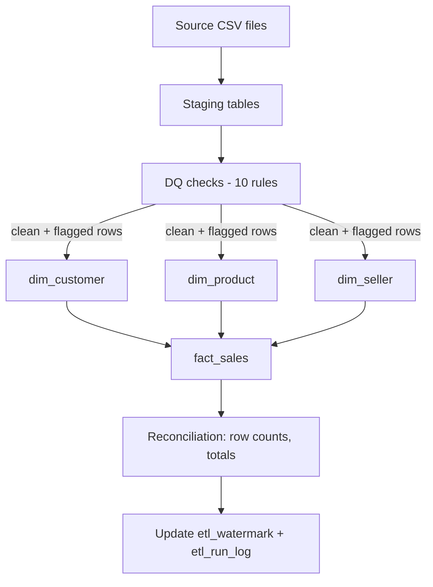

# Day 17: Incremental Load Design on Olist Brazilian E-Commerce

**Tools:** MySQL Workbench (MySQL 8), Excel, VS Code
**Dataset:** Olist Brazilian E-Commerce Public Dataset (Kaggle)
**Scripts:** `sql/01_inventory.sql`, `sql/06_incremental_load.sql`, `sql/07_dq_rules.sql`

> Table names: sources are `orders`, `order_items`, `order_payments`, `order_reviews`, `products`, `sellers`, `geolocation`, and `dim_customer` (used as the customer source). The new tables built in task 6 are named `dim_customer_scd2` and `fact_sales_inc` so they do not overwrite the existing `dim_customer` and `fact_sales`.

> Row counts below are the commonly published Olist counts. Re-run `01_inventory.sql` and paste your own numbers if they differ.

---

## 1. Source inventory

| File | Rows | Key | Assumed update frequency |
|---|---|---|---|
| customers (loaded as dim_customer) | 99,441 | customer_id (one per order; `customer_unique_id` = real person) | Daily (new row with every new order) |
| orders | 99,441 | order_id | Daily, and existing rows change as status moves |
| order_items | 112,650 | order_id + order_item_id | Daily, insert-only |
| order_payments | 103,886 | order_id + payment_sequential | Daily, insert-only |
| order_reviews | 99,224 | review_id (+ order_id, not fully unique) | Daily |
| products | 32,951 | product_id | Weekly |
| sellers | 3,095 | seller_id | Weekly |
| geolocation | 1,000,163 | none (zip prefix repeats) | Static / monthly |
| product_category_name_translation | 71 | product_category_name | Static |

- Update frequency is **assumed**, the dataset is a one-time export.
- Main finding: `customer_id` is not a real customer key. Use `customer_unique_id`.
- Order dates run from 2016 to 2018. 2016 is tiny, most volume is 2017 and 2018.

---

## 2. Source-to-target mapping: fact_sales

**Grain:** one row per order item.
Reason: `order_items` is the most detailed table with price. Payments are order-level, so joining them in would repeat the payment amount on every item and double count revenue. Payments belong in a separate `fact_payment`.

| Target column | Source table.column | Transformation |
|---|---|---|
| sales_key | generated | AUTO_INCREMENT surrogate |
| order_id | order_items.order_id | as is (degenerate dimension) |
| order_item_id | order_items.order_item_id | as is |
| customer_key | orders.customer_id -> customers.customer_unique_id -> dim_customer | lookup the dim version valid on purchase date |
| product_id | order_items.product_id | as is (would be product_key with dim_product) |
| seller_id | order_items.seller_id | as is (would be seller_key with dim_seller) |
| purchase_ts | orders.order_purchase_timestamp | as is, used for watermark |
| purchase_date_key | orders.order_purchase_timestamp | `DATE_FORMAT(ts,'%Y%m%d')` as INT |
| order_status | orders.order_status | as is |
| price | order_items.price | DECIMAL(10,2) |
| freight_value | order_items.freight_value | DECIMAL(10,2) |
| item_total | order_items.price + freight_value | calculated |

Unique key `(order_id, order_item_id)` so a rerun cannot create duplicates.

---

## 3. Source-to-target mapping: dim_customer

| Target column | Source | Transformation |
|---|---|---|
| customer_key | generated | AUTO_INCREMENT surrogate |
| customer_unique_id | customers.customer_unique_id | natural key; if customer row is missing: `'INFERRED-' + customer_id` |
| customer_zip_prefix | customers.customer_zip_code_prefix | as is |
| customer_city | customers.customer_city | `LOWER(TRIM())` |
| customer_state | customers.customer_state | `UPPER(TRIM())`, default `'XX'` if missing |
| effective_from | derived | 1900-01-01 for first version, else date of the order that showed the change |
| effective_to | derived | 9999-12-31 while current |
| is_current | derived | 1 for the latest version |
| is_inferred | derived | 1 if placeholder row |

`customer_id` is not stored in the dim. It is one-per-order, so it only lives in staging as the bridge to `customer_unique_id`.
Olist is anonymised so there is no customer name column.

---

## 4. SCD type per attribute

| Attribute | SCD type | Reason |
|---|---|---|
| customer_unique_id | Type 0 (never changes) | It is the business key |
| zip_prefix, city, state | **Type 2** | A customer can move. Old orders must stay under the old city, otherwise regional sales reports change retroactively |
| City spelling fixes (e.g. case, spaces) | Type 1 (overwrite) | It is a correction, not a real move. `LOWER(TRIM())` in staging stops spelling noise creating fake versions |
| is_inferred | Type 1 | Flag is overwritten once the real row arrives |

City, state and zip are versioned together as one address, so one move = one new row.

---

## 5. Watermark design (order_purchase_timestamp)

**Control table**

```sql
CREATE TABLE etl_watermark (
  table_name VARCHAR(50) PRIMARY KEY,
  last_loaded_ts DATETIME NOT NULL,
  updated_at TIMESTAMP DEFAULT CURRENT_TIMESTAMP ON UPDATE CURRENT_TIMESTAMP
);
```

**Logic per run**
1. Read `last_loaded_ts` for `fact_sales`.
2. Stage orders where `order_purchase_timestamp >= last_loaded_ts`.
3. Load dim, then fact.
4. Set the watermark to `MAX(order_purchase_timestamp)` of the batch, only if steps 2-3 succeeded.

**Design choices and why**
- `>=` not `>`: rows sharing the exact watermark timestamp are not lost. The unique key on the fact ignores the repeats.
- Watermark = max timestamp in the data, not `NOW()`. Using `NOW()` would skip rows if the source lags.
- Watermark moves last. If the load fails midway, the next run just redoes the same window.
- **Known weakness:** purchase timestamp never changes, but `order_status` does. A pure watermark on purchase time will miss status updates on old orders. Fix: re-read the last 7 days each run (lookback) and use `ON DUPLICATE KEY UPDATE order_status = ...` instead of `INSERT IGNORE`. The simulation in task 6 uses `INSERT IGNORE`, so it does not show this.

---

## 6. Incremental load simulation

Script: `sql/06_incremental_load.sql`

- Watermark seeded at `2017-01-01`.
- **Run 1:** `@hi = '2018-01-01'` loads only 2017 rows.
- **Run 2:** `@hi = '9999-12-31'` loads only rows after the watermark (the 2018 rows).
- Run 3 (same settings again) should insert 0 rows, which proves it is safe to rerun.
- Note: 2016 orders (a few hundred) are skipped on purpose to follow "load 2017 first".

| Check | After run 1 | After run 2 | After run 3 |
|---|---|---|---|
| fact_sales rows | _fill in_ | _fill in_ | _same as run 2_ |
| rows_inserted (etl_run_log) | _fill in_ | _fill in_ | 0 |
| watermark | _fill in_ | _fill in_ | _same_ |

Screenshots: _add `etl_run_log`, `etl_watermark`, and rows per year after each run._

**Known simplification:** if one customer shows two different addresses inside a single batch, only the latest is kept, so their earlier order in that batch maps to the latest address. Across batches SCD2 works properly (see the multi-version query in Section C).

---

## 7. Ten DQ rules

Script: `sql/07_dq_rules.sql`

| ID | Rule | Check | Action |
|---|---|---|---|
| DQ01 | order_id is unique | `COUNT(*) - COUNT(DISTINCT order_id)` | Reject duplicates, keep first |
| DQ02 | customer_id not null | `customer_id IS NULL` | Reject, send to error table |
| DQ03 | purchase timestamp not null | `order_purchase_timestamp IS NULL` | Reject (cannot be watermarked) |
| DQ04 | Delivered date is not before purchase date | `delivered < purchase` | Flag, load with date set to NULL |
| DQ05 | price > 0 and freight >= 0 | `price <= 0 OR freight < 0` | Reject |
| DQ06 | order_status in the 8 valid values | `NOT IN (...)` | Flag as 'unknown' |
| DQ07 | No orphan order_items | order_items LEFT JOIN orders, orders null | Reject |
| DQ08 | No orphan orders (customer must exist) | orders LEFT JOIN customers, customer null | Load with inferred dim row (task 8) |
| DQ09 | (order_id, order_item_id) unique | `COUNT(*) - COUNT(DISTINCT ...)` | Reject duplicates |
| DQ10 | Delivered status needs delivered date | `status='delivered' AND date IS NULL` | Flag only, still load |

| ID | Failed rows (my run) |
|---|---|
| DQ01 - DQ10 | _paste results from Workbench_ |

Reject = row goes to an error table and does not reach the fact. Flag = row loads but is marked.

---

## 8. Late-arriving dimension rows

Three different cases, handled differently.

**a) Fact arrives before its customer row (the classic case)**
1. The fact load uses a LEFT JOIN to customers, so the order is not lost.
2. Insert a placeholder dim row: key `INFERRED-<customer_id>`, city `unknown`, state `XX`, `is_inferred = 1`.
3. The fact points to this placeholder's `customer_key`.
4. When the real customer row arrives, **overwrite the placeholder in place** (Type 1 style, same `customer_key`). Existing facts stay correct with no update.
5. Edge case: if the real `customer_unique_id` already exists as another dim row, re-point the facts to that row and retire the placeholder.

Implemented in `06_incremental_load.sql` (staging LEFT JOIN + `is_inferred` + fix-up UPDATE at the end).

**b) Fact arrives after the watermark already passed its date**
Lookback window of 7 days plus the unique key makes the reread harmless.

**c) A customer's address change arrives late**
The new version is applied from the arrival date, not back-dated. Back-dating means rewriting fact keys. Accepted limitation, to be documented.

---

## 9. ETL vs ELT decision

**Decision: ELT.**

- Raw CSVs are loaded as-is into MySQL staging tables, then transformed with SQL inside MySQL.
- Why ELT here:
  - Biggest table is about 1M rows (geolocation), which MySQL handles fine. No need for a separate transform server.
  - Raw data stays in the database, so any bug in the transform can be fixed and replayed without re-downloading files.
  - Transformations are joins, lookups and SCD2, all set-based work that SQL does well.
  - Only tools needed are Workbench and Excel.
- Trade-offs:
  - Raw data sits in the DB before cleaning. Fine here because Olist is anonymised.
  - Transform load runs on the same MySQL server.
- When I would choose ETL instead: sensitive fields that must be masked before they touch the warehouse, non-SQL transforms (parsing files, API calls), or when the target is small and expensive.

---

## 10. Load order and dependencies



| Step | Depends on | Why |
|---|---|---|
| Staging | CSV files | Raw copy |
| DQ checks | Staging | Bad rows are caught before they enter the model |
| dim_customer / dim_product / dim_seller | DQ checks | Independent of each other, can run in parallel |
| fact_sales | all dims | Needs their surrogate keys |
| Reconciliation | fact_sales | Compare staged vs loaded counts |
| Watermark update | Reconciliation passed | Moves last so a failed run is simply repeated |

In this assignment only `dim_customer` is built. `dim_product` and `dim_seller` follow the same pattern.